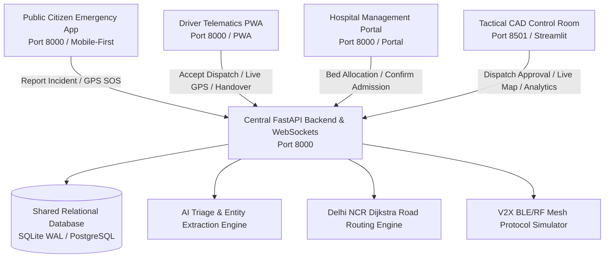

# 🚨 GuardianNodes RoadSoS — AI-Powered Emergency Response Ecosystem (Delhi NCR Node)

[](https://fastapi.tiangolo.com/)
[](https://react.dev/)
[](https://streamlit.io/)
[](https://www.sqlalchemy.org/)
[](#)

> **GuardianNodes RoadSoS** is a production-quality, multi-user emergency response ecosystem connecting citizens, control room dispatchers, emergency vehicle drivers, and regional trauma hospitals through a unified FastAPI backend and persistent relational database.

---

## 🏗️ 4 Interconnected Ecosystem Applications



1. **Public Emergency Reporting App** (`http://localhost:8000`):
   - Mobile-first citizen portal with large one-touch SOS button.
   - 8-step accident reporting with GPS auto-detection, interactive Leaflet map pin-drop, casualty counters, and evidence attachment.
   - Dual Hindi & English language toggle.
   - Real-time incident tracking stepper (`Reported` $\to$ `Verified` $\to$ `Dispatched` $\to$ `On Scene` $\to$ `Resolved`).

2. **Ambulance & Emergency Vehicle Driver PWA** (`http://localhost:8000` $\to$ Driver Tab):
   - Secure driver duty authentication (`medic / medic123`).
   - Active dispatch alert card with incident summary and destination hospital.
   - Turn-by-turn navigation map with GPS simulation test drive mode.
   - Operational workflow action buttons (`Accept Dispatch` $\to$ `En Route` $\to$ `Arrived at Scene` $\to$ `Patient Onboard` $\to$ `At Hospital` $\to$ `Complete Handover`).

3. **Hospital Management Portal** (`http://localhost:8000` $\to$ Hospital Tab):
   - Trauma center authorization (`aiims_admin / hospital123`).
   - Live ICU and General bed availability counters with diversion protocol controls.
   - Real-time incoming ambulance telemetry with estimated arrival times.
   - Transactional bed reservation queue preventing double bookings and negative bed counts.

4. **Tactical CAD Control Room** (`http://localhost:8501`):
   - Palantir-style emergency command center layout with 10 sidebar operational modules.
   - Interactive live Carto-darkmatter tactical map showing grid intersections, fleet units, hospitals, and crash sites.
   - Explainable AI triage analysis, double-dispatch prevention locks, and analytics export.

---

## ⚡ Quick Start & Run Commands

### 1. Single-Click Launch (Windows Batch or PowerShell)
Double-click:
- **`run_ecosystem.bat`** (Starts both FastAPI :8000 and Streamlit :8501)
- Or **`run_ecosystem.ps1`** in PowerShell.

### 2. Manual Command Line Startup

```powershell
# Step 1: Start Central FastAPI Backend & React Frontend (Port 8000)
.\roadsafety\venv\Scripts\python.exe -m uvicorn backend.main:app --app-dir roadsafety --port 8000 --host 0.0.0.0

# Step 2: Start Streamlit Control Room CAD (Port 8501)
.\roadsafety\venv\Scripts\streamlit.exe run roadsafety\app.py --server.port 8501
```

### 3. Run Automated Integration Verification

```powershell
# Run the 12-test automated ecosystem verification suite
.\roadsafety\venv\Scripts\python.exe roadsafety\test_ecosystem.py
```

---

## 🔑 Default Operational Credentials

| Role | Username | Password | Access Scope |
| :--- | :--- | :--- | :--- |
| **Command Admin** | `admin` | `admin123` | Full CAD Control Room & System Administration |
| **CAD Dispatcher** | `operator` | `dispatch123` | Incident Verification, Fleet Dispatch, Bed Requests |
| **Ambulance Paramedic** | `medic` | `medic123` | Driver Navigation PWA, Turn-by-turn telemetry |
| **Hospital Trauma Chief** | `aiims_admin` | `hospital123` | Hospital Bed Reservation, Patient Admission |
| **Lead Engineer** | `utsav` | `utsav123` | System Architecture & Database Oversight |

---

## 📡 Central REST & WebSocket Endpoints

- `GET /api/health`: Health status and database engine metadata.
- `POST /api/auth/login`: User and driver authentication returning signed JWT.
- `POST /api/incidents`: Public incident intake with automated on-device AI triage.
- `GET /api/incidents`: Filterable incident directory.
- `POST /api/incidents/{id}/verify`: Control room verification or rejection.
- `GET /api/vehicles`: Fleet unit status and current coordinates.
- `POST /api/vehicles/dispatch`: Concurrency-locked vehicle assignment.
- `POST /api/vehicles/driver/action`: Driver state transitions.
- `POST /api/vehicles/driver/gps`: Live driver telemetry updates.
- `GET /api/hospitals`: Regional trauma center live bed capacities.
- `POST /api/hospitals/reserve`: Transactional bed reservations.
- `POST /api/routing/route`: Dijkstra path computation on municipal graph.
- `POST /api/mesh/simulate`: V2X 24-byte BLE packet simulation with CRC-32 checksum.
- `WS /ws/telemetry`: Bi-directional real-time event broadcasting.
